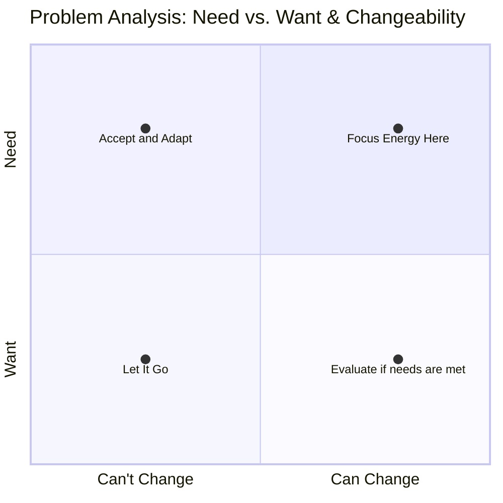

---
tags:
  - overshoot 
  - sustainability 
---

# sustainability

<iframe width="800" height="600" src="https://www.youtube.com/embed/fqA31PKiPmU" title="overshoot day 2026" frameborder="0" allow="accelerometer; autoplay; clipboard-write; encrypted-media; gyroscope; picture-in-picture; web-share" referrerpolicy="strict-origin-when-cross-origin" allowfullscreen></iframe>

- earth evolved the human 300,000 years ago
- we started powering farms using animals for 5000 years
- 150 years ago we powered farms using oil
  - oil power allowed our species to enter ecological overshoot in 1970 at 3 billion
  - oil powered farms over consume natural resources and over pollute
  - this also causes dead zones in the ocean
- estimates are that due to pollution and consumption the earth can now sustain only 2 billion humans
- <https://www.santafe.edu/research/projects/cities-scaling-sustainability>
- focusing your time on wants not needs can unintentionally destroy your needs

> When hungry, I eat; when tired, I sleep
> >> attributed to Master Rinzai

<iframe width="1128" height="635" src="https://www.youtube.com/embed/7HHFH2oQxNA" title="Zen Master Gu Ja - Just eat, sleep and shit" frameborder="0" allow="accelerometer; autoplay; clipboard-write; encrypted-media; gyroscope; picture-in-picture; web-share" referrerpolicy="strict-origin-when-cross-origin" allowfullscreen></iframe>
